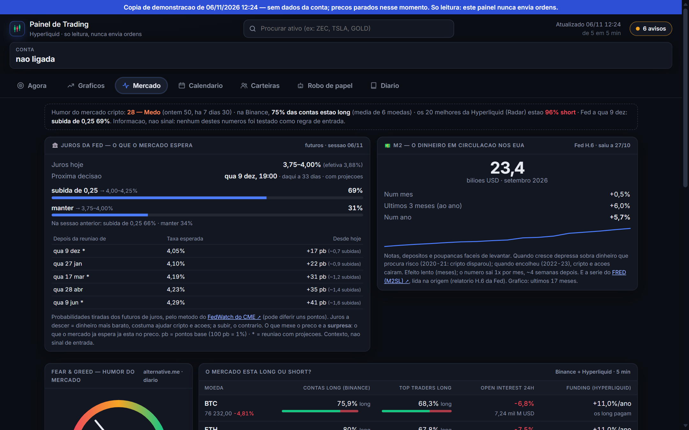
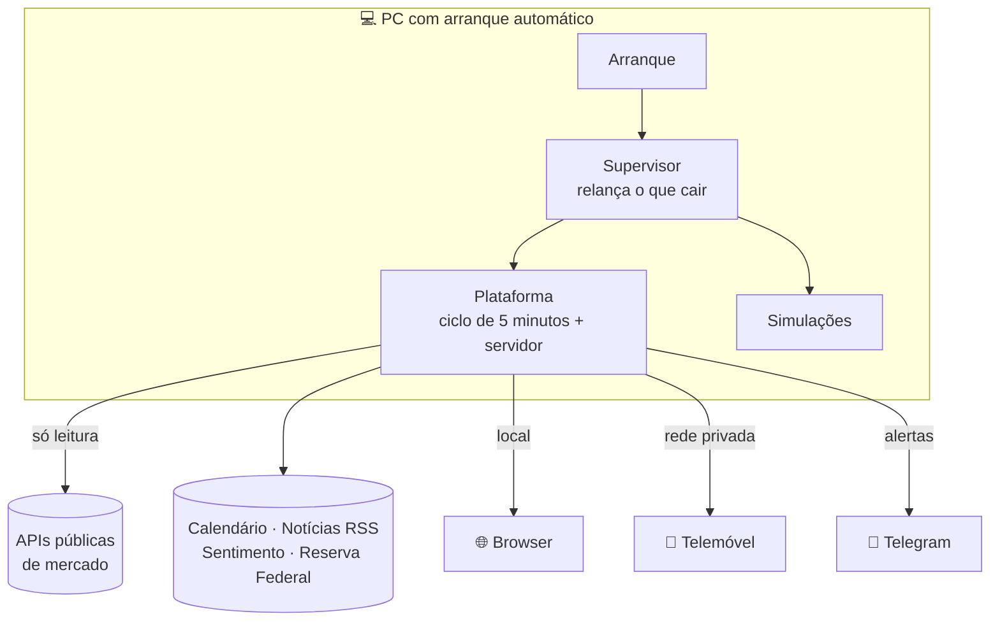
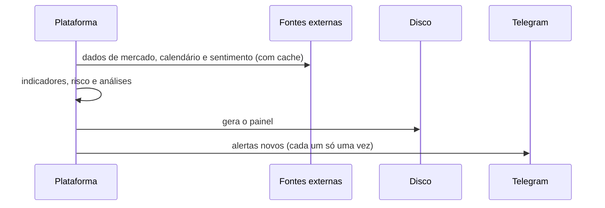
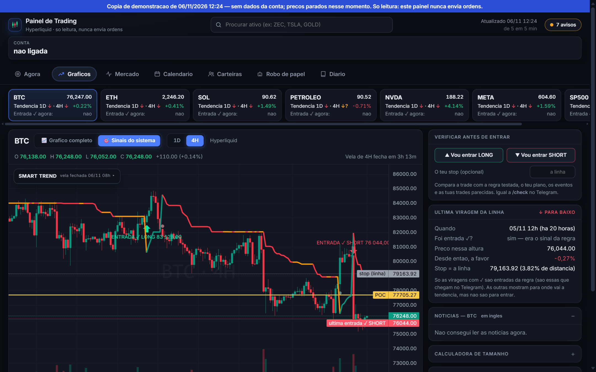
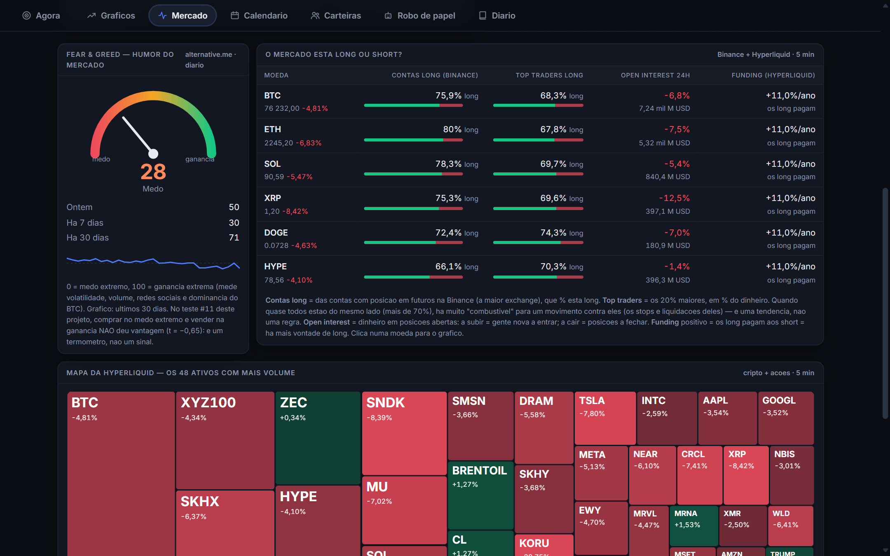
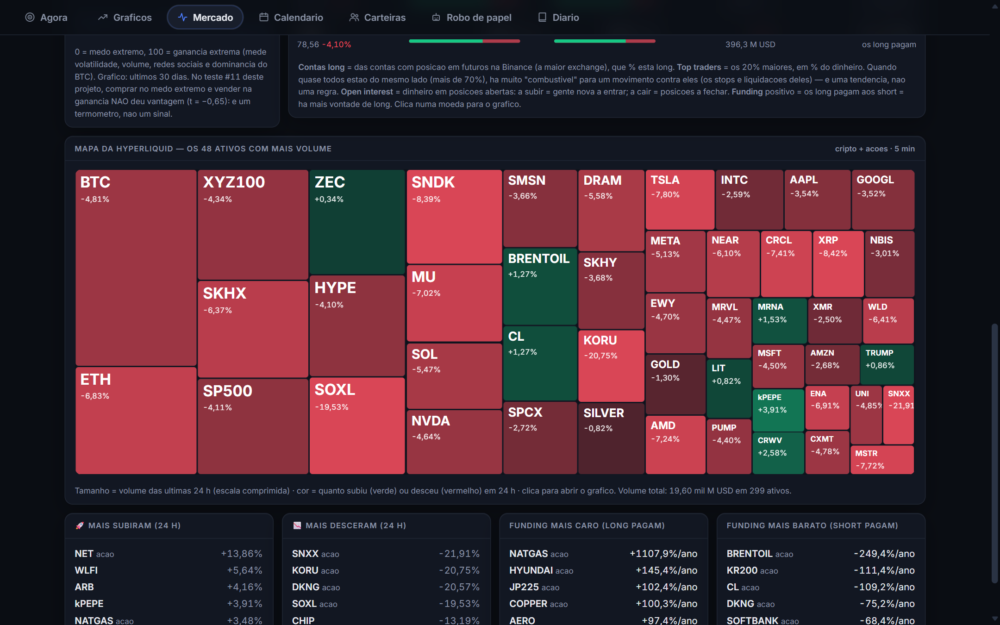
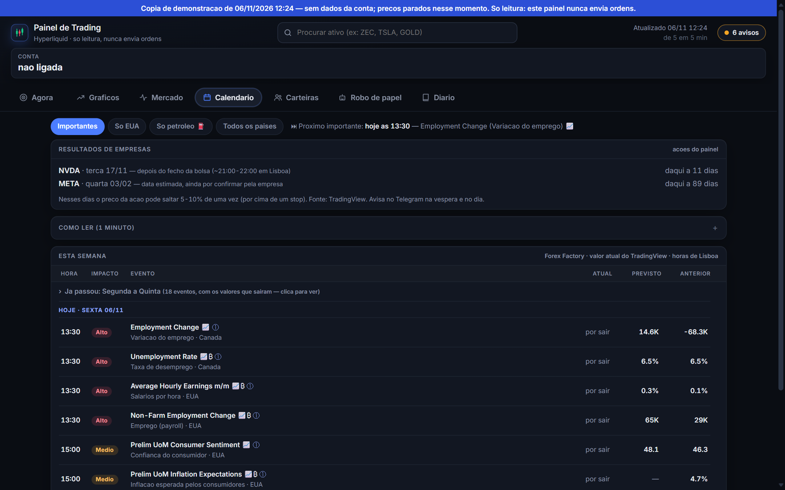
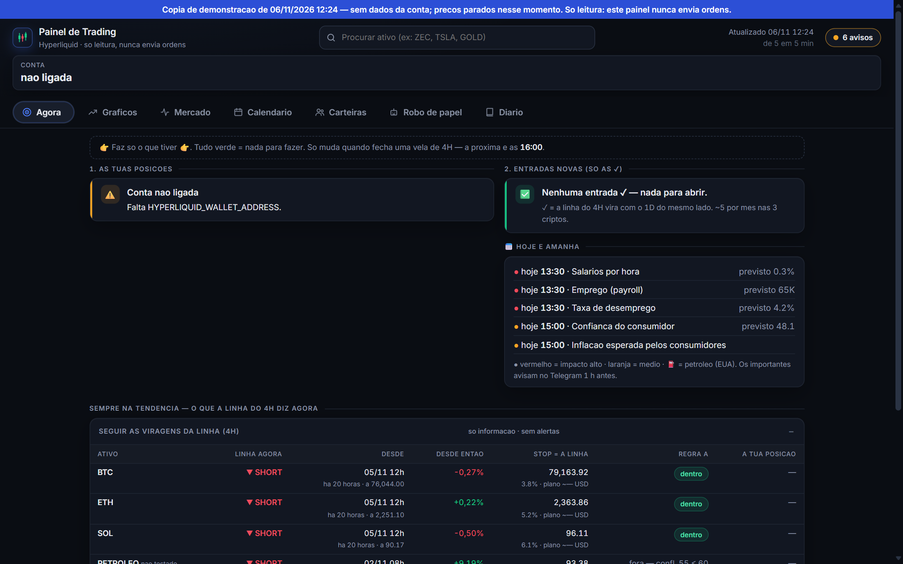
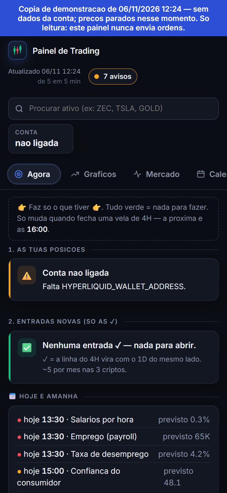

# 📊 Plataforma de Análise de Dados de Mercado

**Um sistema em Python que recolhe dados de várias fontes, testa hipóteses com regras definidas à partida e envia alertas automáticos.**

 

[O projeto](#-o-projeto) · [Competências](#-competências-demonstradas) · [Método](#-método-científico) · [Arquitetura](#%EF%B8%8F-arquitetura) · [Segurança](#-segurança) · [Interface](#%EF%B8%8F-interface) · [Alertas](#-alertas-automáticos)

 

> [!NOTE]
> Esta página só apresenta o projeto. **O código é privado.** As imagens vêm da cópia de demonstração, sem nenhuma conta ligada e com os preços parados no momento em que foi criada. O nome "Painel de Trading" que aparece nas imagens é o nome interno do programa.

> [!IMPORTANT]
> Este é um projeto pessoal de programação e análise de dados. **Nunca envia ordens** e **não é aconselhamento financeiro**.

## 🧭 O projeto

Comecei com uma pergunta simples: as regras que parecem funcionar nos mercados resistem a um teste sério?

Para responder, construí um sistema que corre sozinho no PC: recolhe dados de várias fontes, calcula indicadores, testa hipóteses, simula estratégias sem dinheiro real e apresenta tudo num painel web. O mercado foi o tema. O objetivo foi trabalhar com dados reais, a mudar a toda a hora, e construir um sistema fiável.

## 🧰 Competências demonstradas

| Área | O que o projeto mostra |
|---|---|
| 🐍 **Python** | Cerca de 11 000 linhas, organizadas em módulos |
| 🔌 **Integração de APIs** | Várias fontes externas, com cache, limites de pedidos e tolerância a falhas |
| 📈 **Análise de dados** | Séries temporais, indicadores e simulação de Monte Carlo |
| 🧪 **Método** | Hipóteses pré-registadas, custos incluídos e testes com dados nunca vistos |
| ⚙️ **Fiabilidade** | Processos supervisionados, recuperação automática e arranque com o Windows |
| 🔒 **Segurança** | Modelo de ameaças, segredos fora do código e testes de ataque ao próprio sistema |
| 🖥️ **Interface web** | Painel próprio em HTML, CSS e JavaScript, adaptado ao telemóvel |
| 🤖 **Automação** | Alertas e comandos por um bot do Telegram |

## 🧪 Método científico

É o coração do projeto: saber o que **não** funciona é tão valioso como saber o que funciona. As 21 experiências seguiram as mesmas regras:

1. **Pré-registo:** o protocolo, os parâmetros e o critério ficam escritos antes de correr.
2. **Sem afinar depois:** mudar um parâmetro depois de ver o resultado conta como uma experiência nova.
3. **Critério claro:** t ≥ 2 no agregado e positivo na maioria dos casos.
4. **Custos incluídos:** nada de resultados bonitos que desaparecem na prática.
5. **Testes múltiplos:** resultados à justa ficam como candidatos e são testados a seguir, em simulação, com dados nunca vistos.

> O **t** mede quantas vezes o resultado médio é maior do que o seu erro. Abaixo de 2, não se distingue do acaso.

<b>Ver as 21 experiências</b>

 

| # | Hipótese testada | Resultado |
|---|---|---|
| 1 | Médias móveis 20/50 com filtro 200 | Sem vantagem (t −0,43; em 6 anos, t 1,40) |
| 2 | Carry de funding | Amostra inútil; não paga os custos |
| 3 | Cash-and-carry | Inviável, sem liquidez suficiente |
| 4 | Par relativo de funding | Sem vantagem |
| 5 | Grid trading | **Falha**: a 1 minuto, t −4,16. A 4 horas parecia ganhar, mas era efeito dos dados |
| 6 | Reversão no petróleo perto de máximos | Sem vantagem |
| 7–10 | DMT e 3 variantes | Sem vantagem consistente |
| 11 | Índice Fear & Greed | Sem vantagem (t −0,65) |
| 12 | Escalar contra o movimento, sem stop | Falha em quase todas as janelas de 28 dias |
| 13 | Tendência diária | t 1,21, sem vantagem demonstrada |
| 14 | Tendência a 4 horas | t 1,93, quase |
| 15 | Variantes de saída e alavancagem | Nenhuma positiva |
| **16** | **4 horas só com o diário a favor** | **t 2,14: candidata, em teste com dados novos** |
| 17 | EMA200, RSI e padrão de vela | Quase nunca dispara |
| 18 | #16 fora da amostra | Inconclusivo (t 1,79) |
| 19 | Entrada com confluência ≥ 90 | t 2,28 à justa, não melhor do que a regra base |
| 20 | #16 noutros ativos | Em teste com dados novos |
| 21 | Reagir a notícias | **Falha** depois dos custos (t −1,64) |

**Conclusão honesta:** a maioria das hipóteses não sobreviveu aos custos. Só uma ficou como candidata, e nada está provado. Esse resultado é a parte de que mais me orgulho, porque mostra o método a funcionar.

Para validar as candidatas sem risco, o sistema corre **simulações automáticas** com capital fictício, e cada uma tem o critério de avaliação definido antes de começar.

## 🏗️ Arquitetura

O que dá robustez ao sistema:

- **Supervisor:** relança cada processo que cair, com espera crescente, e avisa no Telegram sem avalanches de mensagens.
- **Vigia de bloqueio:** se um processo encravar, regista onde parou e sai, para ser relançado.
- **Estado seguro:** as simulações gravam de forma atómica e, ao reiniciar, recuperam os dados perdidos com o PC desligado.
- **Cache e limites:** cada fonte tem cache própria, e o sistema continua a funcionar se uma falhar.
- **Separação de lógica:** indicadores, alertas e análise são módulos separados, e cada experiência tem o seu protocolo.

## 🔒 Segurança

| Princípio | Como foi feito |
|---|---|
| 📖 **Só leitura** | Nenhum código envia ordens nem usa chaves de negociação |
| 🔑 **Segredos fora do código** | Tokens e endereços ficam em variáveis de ambiente |
| 🏠 **Nada exposto à internet** | O servidor escuta só no próprio PC e na rede privada, sem portas abertas no router |
| 🤖 **Bot fechado** | Só responde ao dono, e os comandos são de leitura |

Testes feitos a atacar o próprio sistema:

| Ataque simulado | Resultado |
|---|---|
| *DNS rebinding* com `Host` falso | ✅ Recusado (421) |
| Leitura da API com `Host` falso | ✅ Recusada (421) |
| Gravar a partir de outro site (CSRF) | ✅ Recusado (403) |
| Ler ficheiros fora da lista, listar pastas ou usar `../` | ✅ Não encontrado (404) |
| Cabeçalhos `nosniff`, `DENY`, `no-referrer` e `same-origin` | ✅ Presentes |

## 🖥️ Interface

O painel web atualiza-se de 5 em 5 minutos, abre no telemóvel por uma rede privada e permite procurar cerca de 290 ativos.

### Indicadores no gráfico

Dados de vários mercados, com indicadores calculados pelo próprio sistema e a data de cada sinal.

### Dados de sentimento

Vários indicadores num só sítio, cada um com a explicação do que mede. Quando foi testado, a caixa diz qual foi o resultado.

### Visualização de dados

Mapa de calor dos 48 ativos com mais volume, em que o tamanho mostra o volume e a cor mostra a variação.

### Calendário de eventos

Eventos económicos de várias fontes, traduzidos e com explicação.

### Resumo e telemóvel

<table>
  <tr>
    <th width="72%">Resumo do dia</th>
    <th width="28%">No telemóvel</th>
  </tr>
  <tr>
    <td></td>
    <td></td>
  </tr>
</table>

## 📲 Alertas automáticos

Um bot do Telegram envia alertas sem intervenção, e cada um só é enviado uma vez.

| Alerta | Quando chega |
|---|---|
| 📈 **Sinal validado** | Quando uma regra testada dispara |
| 📅 **Calendário** | Uma hora antes de eventos importantes e quando sai o número |
| 🏦 **Dados macro** | Quando as probabilidades da Fed mudam muito ou sai um número novo |
| 📊 **Resumos** | De manhã, à noite e uma revisão semanal |
| 🔌 **Saúde do sistema** | Quando um processo falha ou volta, ou quando o PC passa para a bateria |

| Comando | O que faz |
|---|---|
| `/estado` | Estado do sistema |
| `/grafico ETH` | Gera a imagem de um gráfico |
| `/alerta BTC 80000` | Cria um alerta de preço |
| `/fed` | Situação dos juros da Fed |

## 🛠️ Tecnologias

| Área | Tecnologia |
|---|---|
| Linguagem | Python 3.12 |
| Dados e análise | pandas, NumPy e simulação de Monte Carlo |
| Interface | HTML, CSS e JavaScript |
| Gráficos | TradingView e gráficos próprios |
| Alertas | Bot do Telegram |
| Fontes de dados | Hyperliquid, Binance, Forex Factory, TradingView e Reserva Federal |
| Acesso remoto | Tailscale |

## 💡 O que aprendi

- Testar uma ideia com regras escritas à partida é o que separa dados de opinião.
- Um resultado bonito pode ser só efeito dos dados, e vale a pena desconfiar dele.
- Um sistema que corre sozinho precisa de supervisão, recuperação e alertas tão bons como as funcionalidades.
- Depender de serviços externos obriga a preparar o sistema para quando eles falham.
- Segurança é testar o que se construiu, não só assumir que está bem feito.

---

Projeto pessoal e educativo. Nada aqui é aconselhamento financeiro.

